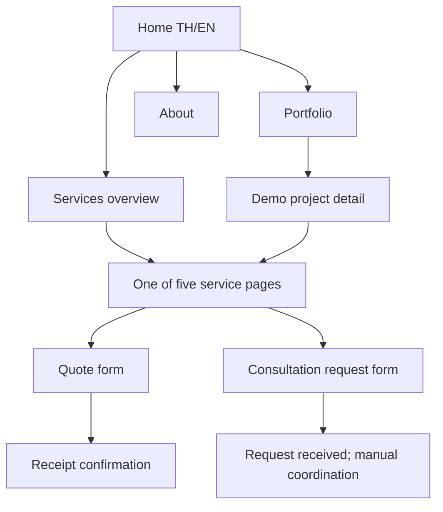

# Phase 03 — User Flow

## Goals
Help visitors understand NEXORA, discover one of five services, assess clearly labelled demo work, and submit an enquiry with minimal friction.

## Flow A — Service discovery
Home (TH/EN) → Services overview → one of five service details → Portfolio/demo (optional) → Quote or Consultation form → submission confirmation.

## Flow B — Quote request
CTA → quote form → choose service → provide project summary, contact details and preferred contact method → validation → server-side submission (integration TBD) → receipt confirmation. Submission is not a quote or contract acceptance.

## Flow C — Consultation request
CTA → consultation form → topic and preferred date/time window → contact details → validation → submission → message that NEXORA will contact the visitor to coordinate. No calendar integration or instant confirmed booking.

## Flow D — Portfolio
Portfolio → demo project detail → explicit “Demo project / ตัวอย่างผลงาน” label → related service → enquiry CTA.

## Flow E — Locale
Language switch preserves equivalent page where available; URL prefixes `/th/` and `/en/`. If translation counterpart is unavailable, route to locale home or closest parent page.

## Form requirements
- Required/optional fields visibly distinguished.
- Inline validation and accessible error summary.
- Preserve entered data after validation errors.
- Success message only after actual server acceptance.
- Do not expose personal form contents to analytics.
- Spam protection and privacy/legal copy required before production.

## Mermaid

